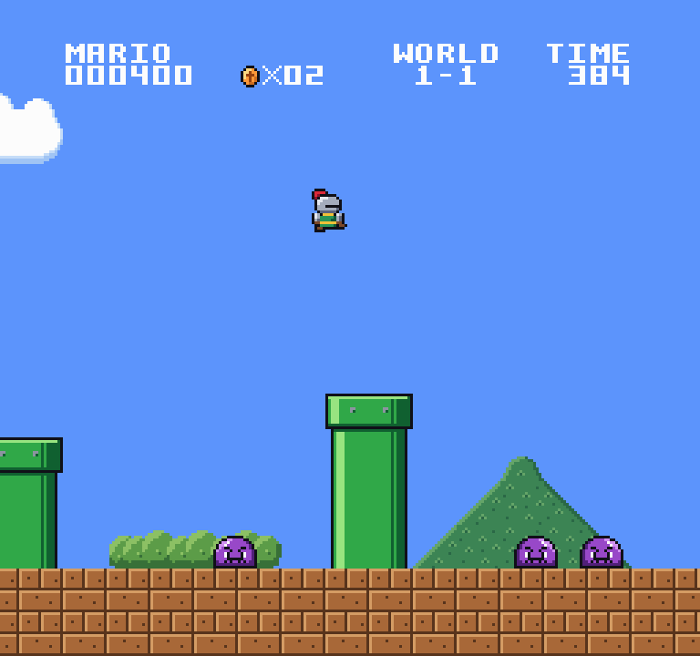
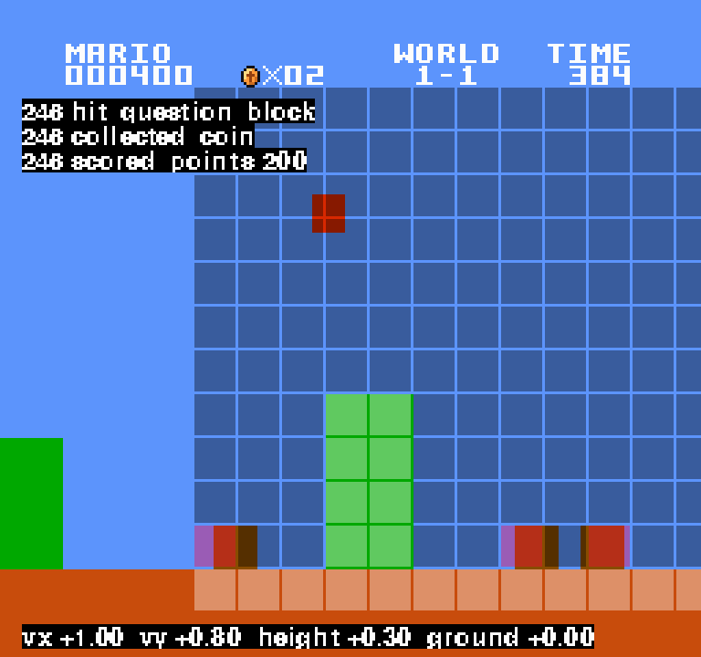
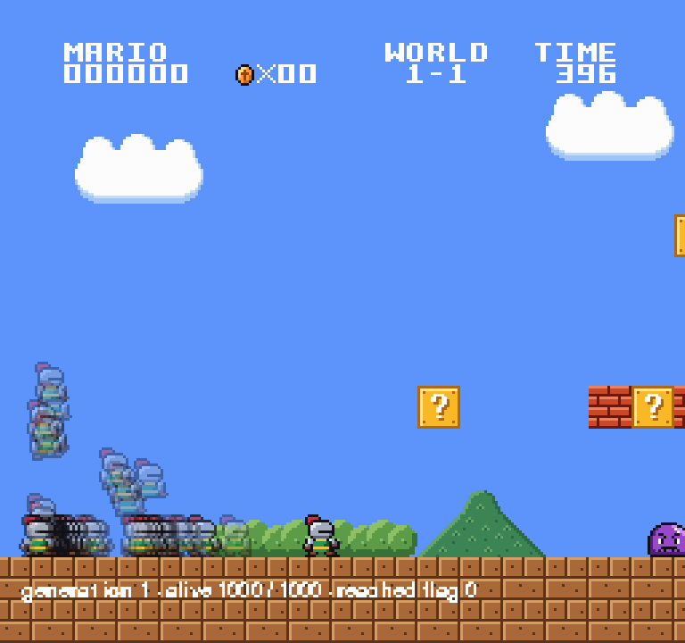
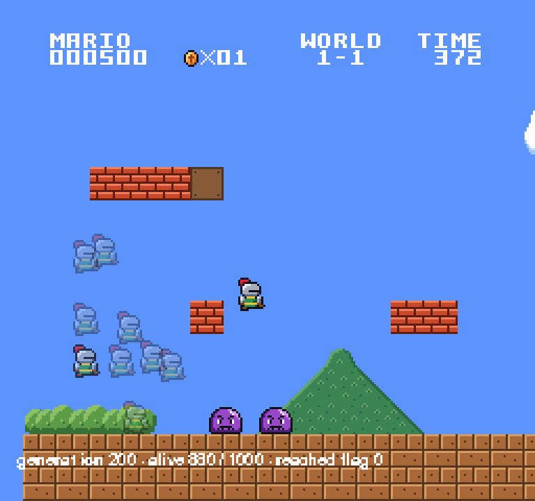
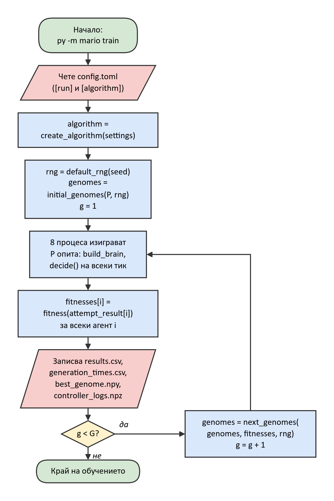
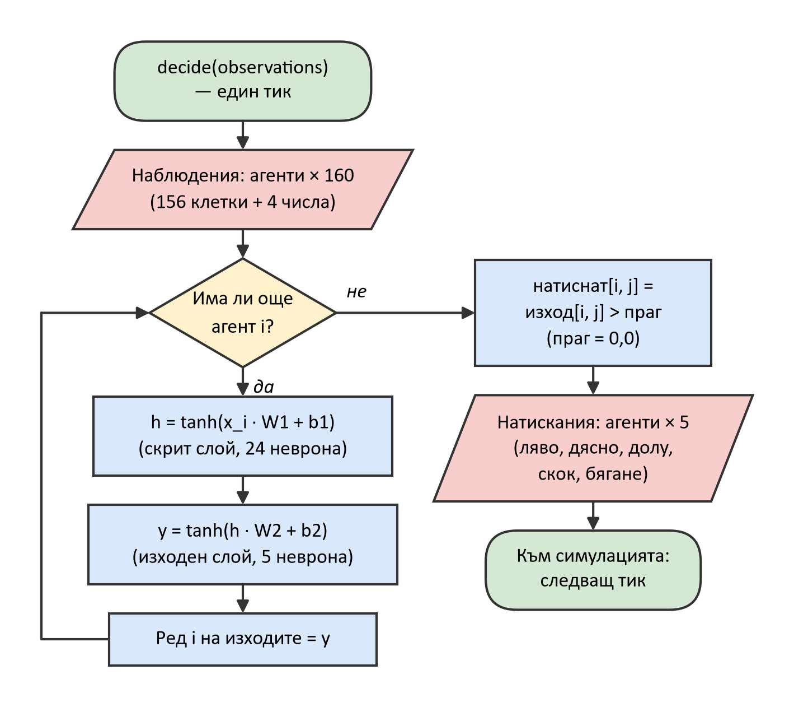
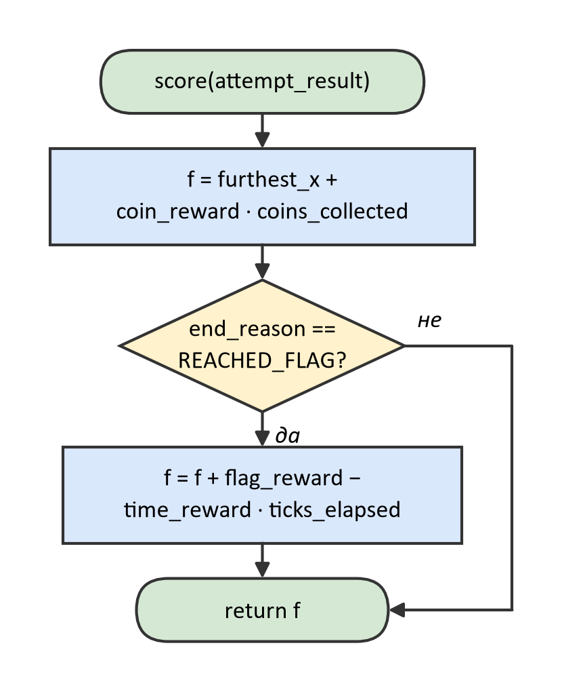
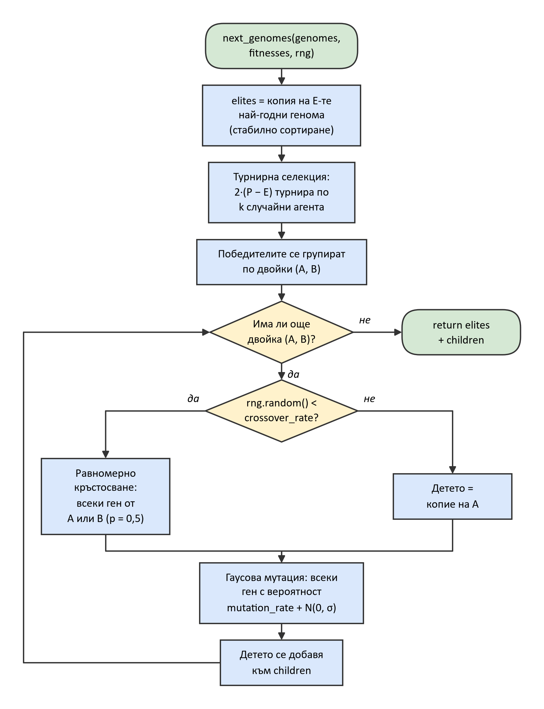

# 1. Въведение

Целта на проекта е изкуствен агент да се научи сам да преминава първото ниво (World 1-1) на класическата платформена игра Super Mario Bros. (Nintendo, 1985), без да му се показва как се играе. За целта е използвана **невроеволюция** – подход от машинното обучение, при който теглата на изкуствена невронна мрежа не се обучават чрез градиенти, а се развиват от **генетичен алгоритъм** [@yao]. Всеки агент управлява героя чрез собствена малка невронна мрежа, която на всеки кадър (тик) получава описание на обкръжението и решава кои бутони да натисне. Хиляда такива агента играят нивото едновременно, най-добрите предават своите „гени“ (теглата на мрежата) на следващото поколение, и след няколко десетки поколения се появяват агенти, които стигат до флага в края на нивото.

Проектът се състои от две части с различен произход:

- **Играта** – реплика на ниво 1-1 с физиката на оригинала, графичен интерфейс с два изгледа, режими за наблюдение на обучението и повторение на записани опити – е изградена с помощта на изкуствен интелект като **платформа** за експериментите.
- **Алгоритъмът за обучение** – невронната мрежа, генетичният алгоритъм и функцията на годност (пакетът `neuroevolution/`) – е написан **ръчно от автора** с помощта на изкуствен интелект (обяснения на понятията и преглед на кода).

Затова тази документация описва играта като **среда**, в която работи алгоритъмът, а подробното описание на кода, блок-схемите, анализът на сложността и приложението с пълния код се отнасят до алгоритъма.

## 1.1. Предимства на алгоритъма

- **Не изисква градиенти.** Обучението с обратно разпространение на грешката изисква диференцируема функция на загубата и „правилен отговор“ за всеки вход. В играта такъв отговор няма – известно е само колко добре е завършил целият опит. Генетичният алгоритъм се нуждае само от едно число за всеки агент – неговата годност [@goldberg].
- **Работи с отложена и рядка награда.** Дали един скок е бил добър, става ясно чак секунди по-късно. Невроеволюцията оценява цялото поведение наведнъж и не трябва да разпределя наградата между отделните решения.
- **Лесно се разпаралелва.** Агентите от едно поколение се оценяват независимо един от друг, затова времето почти линейно намалява с броя на процесорните ядра [@salimans]. В проекта осем процеса играят едновременно.
- **Популацията изследва много решения наведнъж**, което намалява риска търсенето да заседне в един локален оптимум.
- **Проста реализация.** Целият алгоритъм е около 465 реда на Python и използва само библиотеката NumPy [@numpy], без библиотеки за машинно обучение.
- **Конкурентни резултати.** Прости генетични алгоритми, еволюиращи само теглата, постигат резултати, сравними с методите на обучението с подкрепление, при игри на Atari [@such].
- **Пълна възпроизводимост.** Играта е детерминистична, а всяка случайност идва от един генератор с фиксирано семе, затова едно и също обучение, пуснато повторно, дава еднакви резултати.

## 1.2. Недостатъци на алгоритъма

- **Неефективно използване на данните.** За всяко поколение се изиграват 1000 пълни опита, а от всеки опит се използва само едно число. Градиентните методи извличат много повече информация от същия опит.
- **Оценката е скъпа.** Почти цялото време отива за симулиране на играта (вж. раздел 4), а не за самия генетичен алгоритъм.
- **Много хиперпараметри.** Размерът на популацията, вероятността и силата на мутацията, размерът на турнира, броят на елитните агенти и наградите във функцията на годност трябва да се подберат експериментално.
- **Проблемът с пермутациите.** Две мрежи могат да решават задачата еднакво, но с подредени по различен начин скрити неврони. Кръстосването им тогава смесва несвързани неврони и може да развали и двете [@schaffer].
- **Мащабиране.** При директно кодиране всяко тегло е отделен ген. За мрежа с 3 989 тегла това е приемливо, но при милиони тегла пространството на търсене става огромно.
- **Няма гаранция за сходимост.** Популацията може да се сближи преждевременно около посредствено решение, ако разнообразието ѝ се изчерпи.
- **Пренастройване към нивото.** Средата е детерминистична, затова агентите научават конкретното ниво, а не общо умение да играят.

## 1.3. Сфери на приложение

- **Игри и управление на виртуални агенти** – от еволюцията на мрежи с растяща топология (NEAT) [@stanley] до игри на Atari [@such].
- **Роботика и управление** (neurocontrol) – балансиране на обърнато махало, ходене, управление на превозни средства, където липсва „правилен отговор“ за всяко действие [@yao].
- **Търсене на архитектура на невронни мрежи** – еволюиране на структурата на мрежата заедно с теглата [@stanley].
- **Оптимизация и инженерно проектиране** – генетичните алгоритми изобщо се използват за разписания, маршрутизация, проектиране на конструкции и настройка на параметри [@goldberg; @eiben].
- **Обучение с подкрепление в голям мащаб** – еволюционните стратегии се използват като паралелна алтернатива на градиентните методи [@salimans].

# 2. Теоретични основи

## 2.1. Определения на термините

Таблица: Основни термини, използвани в документацията {#tbl:terms}

| Термин | Определение |
|---|---|
| Агент (agent) | Един герой в нивото заедно с генома, който го управлява. |
| Опит (attempt) | Един живот в нивото – от появяването до смърт, застой, изтичане на таймера на нивото или достигане на флага. |
| Тик (tick) | Една стъпка на симулацията; играта върви с 60 тика в секунда. |
| Наблюдение (observation) | Това, което агентът „вижда“ на един тик: решетка от клетки около героя и четири числа за неговото движение – общо 160 числа. |
| Мозък (brain) | Това, което превръща наблюденията в натиснати бутони; изграден е от геномите на група агенти и решава за всички тях на всеки тик. |
| Изкуствена невронна мрежа | Функция, съставена от слоеве изкуствени неврони, която преобразува вектор от входове във вектор от изходи. |
| Неврон | Изчислява претеглена сума на входовете си плюс отместване (bias) и я пропуска през активационна функция. |
| Активационна функция | Нелинейна функция, приложена към сумата на неврона; тук е хиперболичен тангенс (tanh). |
| Ген, геном (genome) | Генът е едно число – тегло или отместване на мрежата. Геномът е плоският масив от всички гени на един агент (3 989 числа). |
| Популация (population) | Множеството агенти, които играят в едно поколение (тук 1000). |
| Поколение (generation) | Един кръг от обучението, в който всеки агент от популацията изиграва нивото веднъж. |
| Годност (fitness) | Числената оценка на един опит; определя кои агенти ще се размножат. |
| Селекция | Изборът на родители за следващото поколение според годността им. |
| Кръстосване (crossover) | Създаване на дете чрез смесване на гените на двама родители. |
| Мутация | Малка случайна промяна в гените на детето. |
| Елитизъм | Пренасяне на най-добрите геноми в следващото поколение без промяна. |
| Застой (stall) | Край на опит, защото героят 180 тика (3 s) не е стигнал по-надясно от досегашния си рекорд. |
| Финиширал (finisher) | Агент, чийто опит е завършил с достигане на флага. |
| Хиперпараметър | Настройка на алгоритъма, която не се учи, а се задава предварително (например вероятността за мутация). |

## 2.2. Изкуствена невронна мрежа

**Неврон.** Изкуственият неврон получава вектор от входове x, умножава всеки вход по съответното тегло w, добавя отместване b и пропуска резултата през активационна функция:

$$ a = tanh(w₁·x₁ + w₂·x₂ + … + wₙ·xₙ + b) = tanh(w · x + b) $$

Теглата определят какво „търси“ невронът във входа, а отместването – колко лесно се активира.

**Активационна функция tanh.** Хиперболичният тангенс изобразява всяко реално число в интервала (−1; 1) и е центриран около нулата. Това съответства на наблюденията, чиито стойности също са около интервала [−1; 1]. Тъй като тук теглата се променят само от еволюцията, не е нужна функция с удобна производна. Важно свойство е, че tanh е строго растяща, затова tanh(z) > 0 точно когато z > 0 – активационната функция на изходния слой не променя кои бутони са натиснати, а само прави изходите по-лесни за четене.

**Слой и многослоен перцептрон.** Слоят е група неврони, които четат едни и същи входове. Теглата им образуват матрица, затова целият слой се изчислява с едно матрично умножение. Използваната мрежа има един скрит слой (многослоен перцептрон, MLP) с размери 160 → 24 → 5:

$$ h = tanh(x · W₁ + b₁),    y = tanh(h · W₂ + b₂),    натиснат_j = (y_j > праг) $$

където x е наблюдението (160 числа), W₁ е матрица 160 × 24, b₁ – вектор с 24 числа, W₂ – матрица 24 × 5, b₂ – вектор с 5 числа, а прагът е 0,0. Петте изхода съответстват на бутоните **наляво, надясно, надолу, скок и бягане**. Скритият слой позволява на мрежата да комбинира факти, например „пропаст отпред **и** героят е на земята → скок“. Без него всеки бутон би бил просто претеглена сума от входовете и мрежата не би могла да изрази логическо „и“ (проблемът XOR).

Таблица: Разгледани алтернативи за мрежата и избор {#tbl:network-alternatives}

| Решение | Алтернатива | Защо не е избрана |
|---|---|---|
| Активация tanh | Сигмоида (0…1) | Не е центрирана около нулата и винаги подава положителен сигнал към следващия слой. |
| | ReLU / Leaky ReLU | Предимствата ѝ са за градиентното спускане, което не се използва; изходът ѝ е неограничен и едно голямо мутирало тегло може да „взриви“ сигнала. |
| | Стъпална функция (перцептрон) | Изходът е само 0 или 1: малка мутация или не променя нищо, или обръща всичко. |
| | Softsign | Подобна на tanh и по-евтина, но без съществена полза при този размер. |
| Един скрит слой | Без скрит слой | Не може да изрази комбинации от условия (XOR). |
| | По-дълбоки мрежи | По-голямо пространство на търсене и по-бавна симулация. |
| | Рекурентна мрежа (RNN) | Дава памет между тиковете, но усложнява генома и оценката. |
| | Конволюционна мрежа (CNN) | Би научила „враг отпред“ веднъж за всички клетки, но е по-сложна за еволюиране. |
| Независим праг за всеки бутон | Softmax / argmax | Избира само **едно** действие, а бутоните трябва да се комбинират (бягане + надясно + скок). |

## 2.3. Генетичен алгоритъм

Генетичният алгоритъм е метод за търсене и оптимизация, вдъхновен от естествения подбор, предложен от Холанд [@holland] и популяризиран от Голдбърг [@goldberg]. Той поддържа **популация** от кандидат-решения, кодирани като **геноми**, и ги подобрява от поколение на поколение:

1. **Инициализация** – създава се начална популация от случайни геноми.
2. **Оценка** – за всеки геном се изчислява годност.
3. **Селекция** – по-годните геноми се избират за родители по-често.
4. **Кръстосване** – от двойки родители се създават деца, които смесват гените им.
5. **Мутация** – в децата се внасят малки случайни промени.
6. **Замяна** – децата (и евентуално най-добрите родители) образуват новото поколение; стъпки 2–6 се повтарят.

Селекцията придвижва популацията към по-добри решения (**експлоатация**), а мутацията и кръстосването внасят нови решения (**изследване**). Балансът между двете е основният въпрос при настройката на алгоритъма [@eiben].

## 2.4. Невроеволюция и кодиране на генома

При невроеволюцията геномът описва невронна мрежа [@yao]. В проекта е използвано **директно кодиране**: всяко тегло и всяко отместване е отделен ген, а геномът е плосък масив от реални числа (float64) в реда W₁, b₁, W₂, b₂, като матриците са разгънати ред по ред ([[tbl:genome]]).

Таблица: Разположение на гените в генома {#tbl:genome}

| Част | Форма | Брой гени |
|---|---|---|
| W₁ – тегла на скрития слой | 160 × 24 | 3 840 |
| b₁ – отмествания на скрития слой | 24 | 24 |
| W₂ – тегла на изходния слой | 24 × 5 | 120 |
| b₂ – отмествания на изходния слой | 5 | 5 |
| **Общо** | | **3 989** (≈ 32 KB) |

**Начални тегла.** Ако теглата на първото поколение се изтеглят равномерно от [−1; 1], сумата от 160 входа става толкова голяма, че tanh „насища“ до ±1 и невроните никога не променят решението си. Затова теглата се изтеглят от нормално разпределение N(0; 1/√n), където n е броят на входовете на неврона (инициализация на ЛеКун [@lecun]), а отместванията започват от 0. Така сумите остават около ±1, а агентите от първото поколение се държат различно един от друг.

Таблица: Разгледани алтернативи за кодирането и инициализацията {#tbl:encoding-alternatives}

| Алтернатива | Защо не е избрана |
|---|---|
| NEAT – еволюция и на структурата на мрежата [@stanley] | Изисква геноми с променлива дължина, а всички мрежи в една група трябва да се изчисляват заедно. |
| Непреки кодирания (CPPN, HyperNEAT), компресирани кодирания | Малък геном генерира теглата – по-сложно, полезно при много по-големи мрежи. |
| Инициализация на Ксавие/Глоро [@glorot] | Близка по смисъл; изборът между двете е несъществен при тази мрежа. |
| Инициализация на Хе | Създадена за ReLU, която не се използва. |
| Нулеви тегла | Всички агенти биха били еднакви и селекцията няма от какво да избира. |

## 2.5. Функция на годност

Целта на агента е да стигне възможно най-надясно, да достигне флага, да използва възможно най-малко време и да събере възможно най-много монети. Функцията на годност е:

$$ f = furthest_x + coin_reward · coins_collected + [ако е достигнал флага] (flag_reward − time_reward · ticks_elapsed) $$

където furthest_x е най-далечната достигната позиция в пиксели (флагът е на около 3 170 px от началото), coins_collected – събраните монети, а ticks_elapsed – продължителността на опита в тикове. Стойностите са coin_reward = 100, flag_reward = 20 000 и time_reward = 100/96 ≈ 1,04.

Два капана определят вида на формулата:

1. **Времето се отчита само за финиширалите.** Ако „по-малко тикове = по-добре“ важеше за всички, агент, загинал след 2 секунди, би бил по-добър от агент, който внимателно е вървял 30 секунди, и еволюцията би отглеждала бързи самоубийци.
2. **Монетата има фиксирана цена в разстояние и във време.** В оригиналната игра монетата носи 200 точки, а всяка оставаща единица време – 50 точки (1 единица = 24 тика). Следователно 1 монета = 4 единици = 96 тика ≈ 1,6 s, откъдето time_reward = coin_reward / 96.

Дори най-бавният финиширал агент (9 600 тика – пълният таймер на нивото) получава поне 20 000 − 1,04 · 9 600 = 10 000 от флага – повече, отколкото който и да е нефиниширал агент може да събере от разстояние и монети. Затова **достигането на флага винаги печели**.

Таблица: Разгледани алтернативи за функцията на годност {#tbl:fitness-alternatives}

| Алтернатива | Защо не е избрана |
|---|---|
| Точките от играта (final_score) | Награждават и сритване на врагове и чупене на тухли, които не водят към флага. |
| Разстояние за тик | Същият капан като в т. 1 – награждава бързата смърт. |
| Многокритериална оптимизация (NSGA-II) [@deb] | Не изисква тегла, но е по-сложна; единната формула е достатъчна, защото приоритетите са ясни. |
| Лексикографско сравнение | Сравнява първо разстоянието, после монетите и времето; трудно се съчетава с турнир по число. |
| Търсене на новост (novelty search) [@lehman] | Награждава ново поведение вместо резултат; полезно при „подвеждащи“ функции, но не е нужно тук. |
| Годност по ранг | Значение има само подредбата – турнирната селекция вече има това свойство. |

## 2.6. Турнирна селекция

При турнирната селекция за всяко място за родител се избират случайно k агента (размер на турнира, тук k = 3) и за родител се взема най-годният от тях [@miller]. Процедурата се повтаря за всяко място. Тъй като турнирът само **сравнява** годностите, огромният бонус за флага не изкривява селекцията: при селекция с рулетка (вероятност, пропорционална на годността) един финиширал агент би заел почти всички места. По-голям турнир означава по-силен **натиск на селекцията** – по-бърз напредък, но и по-бърза загуба на разнообразие.

Разгледани алтернативи: селекция с рулетка, стохастично универсално извадково избиране (SUS), селекция по ранг, отрязваща селекция (truncation), селекция на Болцман [@eiben]. Всички те или зависят от мащаба на годността, или изискват сортиране на цялата популация, или дават по-труден контрол върху натиска.

## 2.7. Равномерно кръстосване

При равномерното кръстосване за всеки ген на детето се „хвърля монета“ (вероятност 0,5) дали генът да дойде от първия или от втория родител [@syswerda]. Кръстосването се прилага с вероятност crossover_rate = 0,7; в останалите случаи детето е копие на първия родител. И в двата случая след това следва мутация.

Уловката е **проблемът с конкуриращите се конвенции** (пермутациите) [@schaffer]: две мрежи могат да вършат една и съща работа със скрити неврони в различен ред. Смесването на гените им тогава смесва несвързани неврони. Затова кръстосването в проекта се разглежда като експеримент, а не като гарантирано подобрение.

Разгледани алтернативи: едноточково и двуточково кръстосване; аритметично кръстосване (BLX-α) и симулирано двоично кръстосване (SBX), които създават деца **между** стойностите на родителите; кръстосване по цели неврони, което смекчава проблема с пермутациите; генетичен алгоритъм само с мутация, с който Such и др. еволюират играчи на Atari [@such].

## 2.8. Гаусова мутация

Всеки ген на детето с вероятност mutation_rate = 0,05 получава добавено случайно число от нормалното разпределение N(0; σ), където σ = mutation_strength = 0,05. Така средно около 200 от 3 989 гена се променят малко – в мащаба на началните тегла. Твърде силната мутация прави децата случайни, а твърде слабата прави напредъка бавен – това е компромисът между изследване и експлоатация.

Разгледани алтернативи: замяна на гена с ново случайно число; малка промяна на **всеки** ген, както при еволюционните стратегии [@salimans] и CMA-ES; самоадаптираща се сила на мутацията, при която σ е част от генома; правилото на 1/5 успех и намаляваща с времето сила.

## 2.9. Елитизъм

Най-добрите E = 10 генома (1 % от популацията) се копират в следващото поколение **без промяна**, а останалите 990 се създават чрез селекция, кръстосване и мутация. Играта е детерминистична, затова елитният агент постига отново същата годност и най-добрата годност в популацията (почти) никога не намалява. При равна годност печели агентът с по-малък индекс – същото правило, което използва и записът на обучението.

Разгледани алтернативи: без елитизъм; стратегиите (μ + λ) и (μ, λ), които определят дали родителите се състезават с децата си; генетичен алгоритъм в стационарен режим (steady-state), при който на всяка стъпка се заменя само един агент; „зала на славата“ от най-добрите агенти досега.

## 2.10. Обобщение на избора

Таблица: Обобщение на решенията и стойностите на хиперпараметрите {#tbl:decisions}

| Решение | Избор | Настройка в config.toml |
|---|---|---|
| Форма на мрежата | 160 → 24 → 5, един скрит слой | hidden_layer_size = 24 |
| Активация | tanh в двата слоя | – |
| Правило за натискане | бутонът е натиснат, ако изходът е > 0 | button_press_threshold = 0.0 |
| Геном | директно кодиране W₁, b₁, W₂, b₂; 3 989 гена float64 | – |
| Начални тегла | N(0; 1/√n) (ЛеКун), отмествания 0 | – |
| Годност | разстояние + монети + (бонус за флага − време) | coin_reward = 100, flag_reward = 20000, time_reward = 100/96 |
| Селекция | турнир | tournament_size = 3 |
| Мутация | гаусова, ген по ген | mutation_rate = 0.05, mutation_strength = 0.05 |
| Кръстосване | равномерно | crossover_rate = 0.7 |
| Елитизъм | най-добрите 1 % без промяна | elite_count = 10 |
| Популация | 1000 агента, фиксирано семе | population_size = 1000, seed = 1 |

# 3. Практическо приложение

## 3.1. Описание на избрания сценарий

**Средата.** Агентите играят реплика на ниво 1-1, която възпроизвежда физиката, враговете, блоковете, тръбите, бонусната стая и флага на оригинала. Симулацията върви с 60 тика в секунда и е напълно детерминистична: едни и същи натиснати бутони винаги дават един и същ опит. Всеки опит завършва при първото от следните събития:

- **смърт** – допир с враг или падане в пропаст;
- **достигане на флага** – успешно преминаване на нивото;
- **изтичане на таймера** – 400 единици по 24 тика (9 600 тика ≈ 160 s);
- **застой** – 180 тика (3 s) без нов рекорд надясно; правилото е добавено, за да не губят време агенти, които стоят на място.

**Наблюдението** е вектор от 160 реални числа ([[fig:debug-view]]):

- **156 клетки** от решетка 13 × 12 около героя – 3 колони назад, неговата колона и 9 напред, редовете от 2 до 13 на екрана. Всяка клетка е 0 (празна), +1 (твърд блок: земя, тухла, блок с въпросителен знак, тръба, стълба) или −1 (враг);
- **4 числа за движението**: хоризонтална скорост (−1…1), вертикална скорост (около −1…1), височина в рамките на решетката и дали героят е на земята (0 или 1).

**Действията** са 5 бутона – наляво, надясно, надолу, скок и бягане, като на всеки тик всеки бутон е или натиснат, или не. Агентите вземат решение на всеки тик.

**Обучението.** Едно обучение (run) започва с 1000 агента със случайни мрежи. Всяко поколение всички 1000 агента изиграват по един опит, получават годност, и от тях се създава следващото поколение. Използваните настройки са в [[tbl:decisions]]. Критерият за успех на проекта е поне един агент да достигне флага в обучение с 1000 агента и 100 поколения.

## 3.2. Описание на потребителския интерфейс

Програмата се управлява от командния ред. Командите са дадени в [[tbl:commands]].

Таблица: Команди на програмата {#tbl:commands}

| Команда | Действие |
|---|---|
| py -m mario play | Игра на нивото с клавиатурата (без алгоритъма). |
| py -m mario train [config] | Обучение без прозорец (най-бързият режим); на всеки ред в конзолата се отпечатват номерът на поколението, най-добрата и средната годност и секундите. |
| py -m mario train [config] --watch | Обучение с прозорец: всяко поколение се показва на живо в реално време; затварянето на прозореца спира обучението. |
| py -m mario replay ‹папка› [--generation N] | Повторение на цяло записано поколение – всички агенти като „призраци“. |
| py -m mario replay ‹папка› [--generation N] --best | Повторение само на най-добрия агент от поколението, включително слизането по флага. |
| py -m mario stats ‹папка› [още папки…] | Графики и обобщение на едно обучение или сравнение на няколко. |

Таблица: Клавиши в прозореца {#tbl:keys}

| Клавиш | Действие |
|---|---|
| ← → ↓ | наляво, надясно, надолу (само в режим на игра) |
| X | скок (само в режим на игра) |
| Z | бягане (само в режим на игра) |
| F1 | превключване между изгледа със спрайтове и диагностичния изглед (във всички режими) |
| Esc | изход (във всички режими) |

**Прозорецът** показва екрана на оригиналната игра (256 × 240 пиксела), увеличен три пъти, с 60 кадъра в секунда. В горната част е лентата със състоянието (HUD): точки, монети, свят и оставащо време. Има два изгледа, между които се превключва с F1:

- **Изглед със спрайтове** ([[fig:sprite-view]]) – нивото с рисувани графики.
- **Диагностичен изглед** ([[fig:debug-view]]) – всички обекти като цветни правоъгълници (hitbox). Върху тях е наложена решетката на наблюдението на следения агент: всяка клетка е оцветена според стойността си (+1 зелено, −1 лилаво), а най-долу са четирите числа за движението (vx, vy, height, ground). Отляво горе се показват последните игрови събития – удар на блок, събрана монета, победен враг, получени точки. Този изглед показва точно това, което вижда невронната мрежа.

{#fig:sprite-view width=10}

{#fig:debug-view width=10}

**Наблюдение на обучението и повторение.** При `train --watch` и при повторение на цяло поколение камерата следва най-десния жив агент. До 100 други агента се рисуват полупрозрачни („призраци“), а всеки агент изчезва, когато опитът му приключи. Лентата със състоянието получава допълнителен ред „generation N · alive A / P · reached flag F“ – номер на поколението, живи агенти от общо P и брой достигнали флага ([[fig:ghosts-1]] и [[fig:ghosts-200]]). Повторенията винаги се възстановяват от записаните натискания на бутоните, а не чрез повторно изпълнение на мрежата, затова съвпадат точно с оригиналния опит.

{#fig:ghosts-1 width=10}

{#fig:ghosts-200 width=10}

**Запис на обучението.** Всяко обучение се записва в собствена папка `runs/ДАТА_ЧАС_име/` с копие на конфигурацията, файл `results.csv` (по един ред за всеки агент от всяко поколение: годност, причина за края, най-далечна позиция, тикове, точки, монети), `generation_times.csv` (секунди на поколение), а за всяко поколение – най-добрия геном (`best_genome.npy`) и натисканията на всички агенти (`controller_logs.npz`), от които се правят повторенията.

## 3.3. Описание на кода

### 3.3.1. Структура и връзка с играта

Алгоритъмът е в пакета `neuroevolution/` – 15 файла, около 465 реда. Всеки клас има една отговорност ([[tbl:modules]]).

Таблица: Файлове на пакета neuroevolution {#tbl:modules}

| Файл | Съдържание |
|---|---|
| \_\_init\_\_.py | Изнася единствената входна точка create_algorithm. |
| algorithm.py | MarioNeuroevolution – сглобява всички части и реализира четирите метода, които играта извиква; create_algorithm(settings). |
| algorithm_settings.py | AlgorithmSettings – непроменяем клас, който чете таблицата [algorithm] от config.toml и отхвърля липсващи, непознати или невалидни настройки. |
| constants.py | INPUT_SIZE = 160 и OUTPUT_SIZE = 5, взети от играта. |
| neuron.py | Един неврон (учебна стъпка, заменена от матричното изчисление на слоя). |
| layer.py | Layer – слой: tanh(входове · W + b). |
| neural_network.py | NeuralNetwork – слоеве един след друг. |
| brain.py | Brain – решава за група агенти: ред i от наблюденията → мрежата на агент i → натиснати бутони. |
| genome_layout.py | GenomeLayout – брой гени, разгъване (pack) и сгъване (unpack) на генома в тегла и отмествания. |
| random_genomes.py | Случайни геноми с инициализация на ЛеКун. |
| fitness_function.py | FitnessFunction – функцията на годност. |
| tournament_selection.py | TournamentSelection – турнирна селекция. |
| uniform_crossover.py | UniformCrossover – равномерно кръстосване. |
| gaussian_mutation.py | GaussianMutation – гаусова мутация. |
| elitism.py | Elitism – избор на елитните геноми. |

**Връзка с играта.** Играта управлява цикъла на обучението, а алгоритъмът се „включва“ в нея през абстрактния клас `NeuroevolutionAlgorithm` с четири метода:

- `initial_genomes(population_size, rng)` – началните геноми;
- `build_brain(genomes)` – мозък за група агенти;
- `fitness(attempt_result)` – годността на един опит;
- `next_genomes(genomes, fitnesses, rng)` – следващото поколение.

Единственото място в играта, което импортира пакета, е `mario/modes/train_mode.py` (`from neuroevolution import create_algorithm`). Всяка случайност идва от генератора `rng`, който играта създава от семето на обучението и подава на алгоритъма – затова обучението е възпроизводимо. Тази граница позволява играта и алгоритъмът да се разработват и тестват поотделно.

### 3.3.2. Цикъл на обучението

Цикълът на едно обучение е показан на [[fig:flow-training]]. След прочитане на конфигурацията се създава алгоритъмът и началната популация. За всяко поколение пул от 8 процеса изиграва всички опити: популацията е разделена на 16 групи (по 2 на процес), за всяка група се изгражда мозък чрез `build_brain` и на всеки тик се извиква `decide`. След това за всеки опит се изчислява годността, поколението се записва на диска и – ако има още поколения – `next_genomes` създава следващото.

{#fig:flow-training}

### 3.3.3. Вземане на решение от агента

`build_brain` разгъва генома на всеки агент от групата чрез `GenomeLayout.unpack` в две двойки (тегла, отмествания), създава от тях два обекта `Layer` и ги подрежда в `NeuralNetwork`. Разгъването не копира данни – матриците са изгледи (views) върху самия геном. На всеки тик `Brain.decide` получава матрица с по един ред наблюдения за всеки агент от групата, пропуска всеки ред през мрежата на съответния агент и сравнява изходите с прага ([[fig:flow-decision]]). Резултатът е логическа матрица агенти × 5 – натиснатите бутони.

{#fig:flow-decision}

### 3.3.4. Функция на годност

`FitnessFunction.score` пресмята годността от резултата на опита (`AttemptResult`) по формулата от т. 2.5 ([[fig:flow-fitness]]). Бонусът за флага е отделен в метода `finish_bonus`, който връща 0 за всеки нефиниширал агент.

{#fig:flow-fitness width=10.5}

### 3.3.5. Създаване на следващото поколение

`MarioNeuroevolution.next_genomes` ([[fig:flow-next]]) работи така:

1. `Elitism.elites` сортира годностите в низходящ ред със стабилно сортиране (`np.argsort(-fitnesses, kind="stable")`) и връща копия на първите E генома – при равенство печели по-малкият индекс.
2. `TournamentSelection.select` избира наведнъж 2·(P − E) родители: изтегля матрица от случайни индекси с размер (брой места × k), взема годностите им и за всеки ред избира победителя с `np.argmax`. Изчислението е векторизирано, без цикъл в Python.
3. Родителите се разделят на двойки (A, B) – четните и нечетните места.
4. За всяка двойка `UniformCrossover.crossover` с вероятност 0,7 създава дете с `np.where(маска, A, B)`, където маската е случаен логически вектор с вероятност 0,5; иначе детето е копие на A.
5. `GaussianMutation.mutate` създава маска на избраните гени (вероятност 0,05) и добавя `маска · N(0; σ)` към копие на детето. Родителите никога не се променят.
6. Резултатът е `елити + деца` – отново P генома.

{#fig:flow-next}

### 3.3.6. Тестване

Всеки компонент е проверен с автоматични тестове с pytest – 15 тестови файла, 134 теста, които се изпълняват за около 1–2 секунди. Сред проверките са:

- неврон с ръчно пресметнат резултат и насищане на tanh при много големи суми;
- мрежа 2 → 2 → 1 с подбрани тегла, сравнена с ръчно изчисление;
- броят на гените е 3 989 за 160 → 24 → 5, а `pack(unpack(g))` връща същия геном;
- разпределението на началните тегла има отклонение ≈ 1/√n;
- една монета струва точно 96 тика за финиширал агент, а най-бавният финиширал агент побеждава най-добрия възможен нефиниширал;
- при фиксиран генератор по-годните агенти се избират по-често, а турнир с размер 1 избира равномерно;
- при мутация се променят около rate · 3 989 гена, а родителят остава непроменен;
- елитите са точно най-добрите E, с правилото за равенство;
- всеки ген на детето идва от един от двамата родители, а при вероятност 0 детето е копие.

Тестовете са в папката `tests/neuroevolution/` в хранилището на проекта [@repo].

# 4. Изчислителна сложност

Сложността е изразена чрез величините в [[tbl:symbols]].

Таблица: Означения {#tbl:symbols}

| Означение | Смисъл | Стойност в проекта |
|---|---|---|
| P | размер на популацията | 1000 |
| E | брой елитни геноми | 10 |
| k | размер на турнира | 3 |
| I, H, O | размери на входния, скрития и изходния слой | 160, 24, 5 |
| G | брой гени: I·H + H + H·O + O | 3 989 |
| T | продължителност на един опит в тикове (средно T̄) | от ≈ 212 (поколение 1) до ≈ 1 100 |
| N | брой поколения | 100–500 |
| C | цена на един тик на симулацията на играта за един агент | – |

**Решение на един агент за един тик** (`Layer.forward` два пъти): матрично-векторно умножение 1 × I по I × H и 1 × H по H × O, плюс H + O изчисления на tanh – O(I·H + H·O) = 160·24 + 24·5 = **3 960 умножения със събиране**. Сложността е линейна по броя на теглата, т.е. O(G).

**Изиграване на едно поколение:** O(P · T̄ · (G + C)). Мозъкът пази реда на агент, чийто опит е приключил, докато не приключи цялата му група, затова по-точно цената на една група с размер g е O(g · T_max · G), където T_max е най-дългият опит в групата.

Таблица: Сложност на стъпките на генетичния алгоритъм за едно поколение {#tbl:complexity}

| Стъпка | Време | Памет |
|---|---|---|
| initial_genomes (само веднъж) | O(P·G) | O(P·G) |
| build_brain | O(P) – разгъването създава изгледи, без копиране | O(P) |
| fitness за всички агенти | O(P) | O(1) |
| Elitism.elites | O(P log P + E·G) – сортиране и копиране | O(P + E·G) |
| TournamentSelection.select | O(P·k) | O(P·k) |
| UniformCrossover (всички деца) | O(P·G) | O(P·G) |
| GaussianMutation (всички деца) | O(P·G) | O(P·G) |
| **next_genomes общо** | **O(P log P + P·k + P·G) = O(P·G)** | **O(P·G)** |

Тъй като G ≫ log P и G ≫ k, стъпката на генетичния алгоритъм се свежда до **O(P·G)** – линейна по броя на агентите и по броя на гените. Паметта за една популация е P·G·8 байта ≈ 1000 · 3 989 · 8 B ≈ **32 MB** (по време на next_genomes съществуват старата и новата популация – около 64 MB).

**Цяло обучение:** O(N · P · (T̄ · (G + C) + G)). Изиграването струва T̄ пъти повече от размножаването, затова доминира. С 8 процеса времето за изиграване се разделя приблизително на 8, а стъпката на генетичния алгоритъм се изпълнява в главния процес.

**Измерени времена.** Теоретичната оценка е проверена с измервания на същия компютър (4 ядра / 8 нишки) ([[tbl:measurements]]). Измерванията са правени, докато паралелно върви друго обучение, затова са горна граница.

Таблица: Измерени времена {#tbl:measurements}

| Измерване | Време |
|---|---|
| initial_genomes за 1000 агента | 0,17 s |
| next_genomes за 1000 агента | 0,28 s |
| build_brain за група от 63 агента | 0,5 ms |
| Brain.decide за 63 агента, един тик | 1,3 ms (≈ 21 µs на агент) |
| Поколение без прозорец, поколение 1 (средно 212 тика на опит) | 6,7 s |
| Поколение без прозорец, поколение 165 (средно 1 033 тика на опит) | 29,8 s |
| Поколение без прозорец, средно на агент-тик (8 процеса) | ≈ 31 µs |

Изводите са:

- **Времето без прозорец расте линейно с общия брой изиграни тикове** – корелацията между секундите на поколение и сумата от тиковете на всички опити е 0,89. Тиковете на опит растат, защото агентите оцеляват по-дълго, затова по-късните поколения са по-бавни.
- **Генетичният алгоритъм е пренебрежим** – 0,28 s от 7–30 s на поколение (около 1–4 %). Почти цялото време е изиграването на опитите: симулацията на играта и изчисляването на мрежите.
- **При обучение с прозорец** (`--watch`) **времето не зависи от сложността**, а от най-дългия опит: опитите се показват в реално време (60 тика в секунда), затова поколението трае около T_max / 60 секунди (корелация 1,0), средно около 40 s.
- Най-голямата възможна оптимизация е изчисляването на мрежите на цялата група с едно тензорно умножение (`np.matmul` с размер група × I × H) вместо цикъл в Python. Предварителните измервания показват около 2 пъти по-бързо решение, но сложността остава същата.

# 5. Получени резултати

==Този раздел ще бъде попълнен след събирането на допълнителни данни от обучението.==

==Планирано съдържание: таблица по поколения (най-добра, средна и медианна годност, най-далечна позиция, брой финиширали); графиките от командата py -m mario stats (годност по поколения, разстояние, причини за края на опитите, монети и време, секунди на поколение); поколението, в което агент за първи път достига флага; изображения от повторението на най-добрия агент.==

# 6. Източници

[[references]]

# 7. Приложение: пълен код на алгоритъма

Следва пълният код на пакета `neuroevolution/`, конфигурационният файл `config.toml` и модулът `mario/modes/train_mode.py` – единственото място, където играта извиква алгоритъма. Кодът е включен автоматично от файловете в хранилището [@repo] при генерирането на документа.

[[appendix]]
